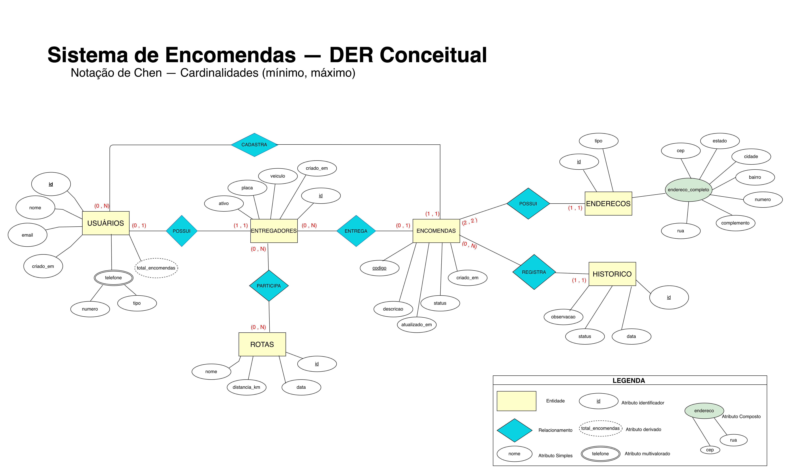
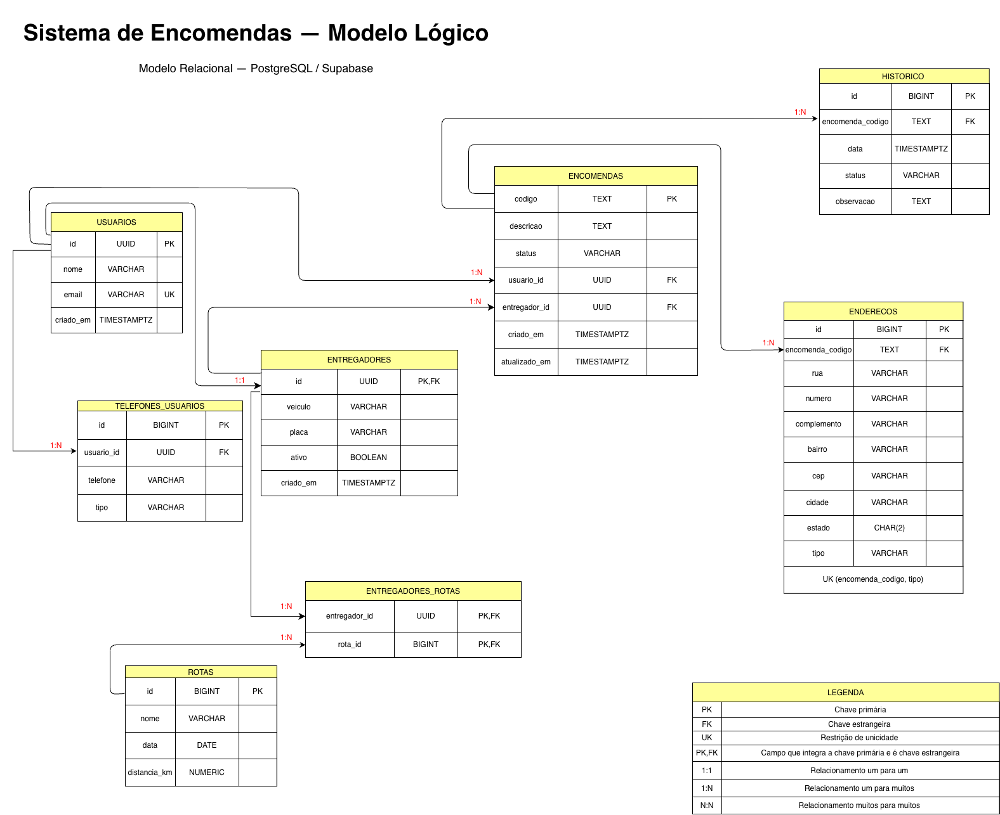
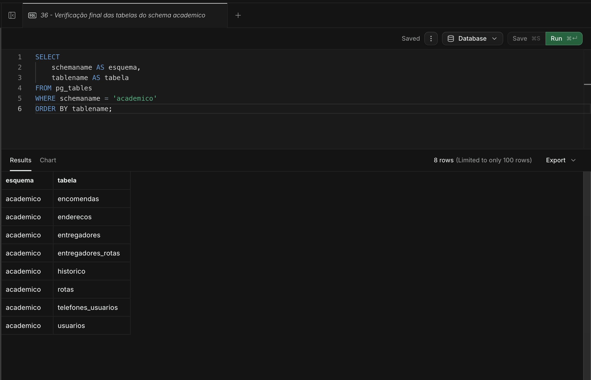
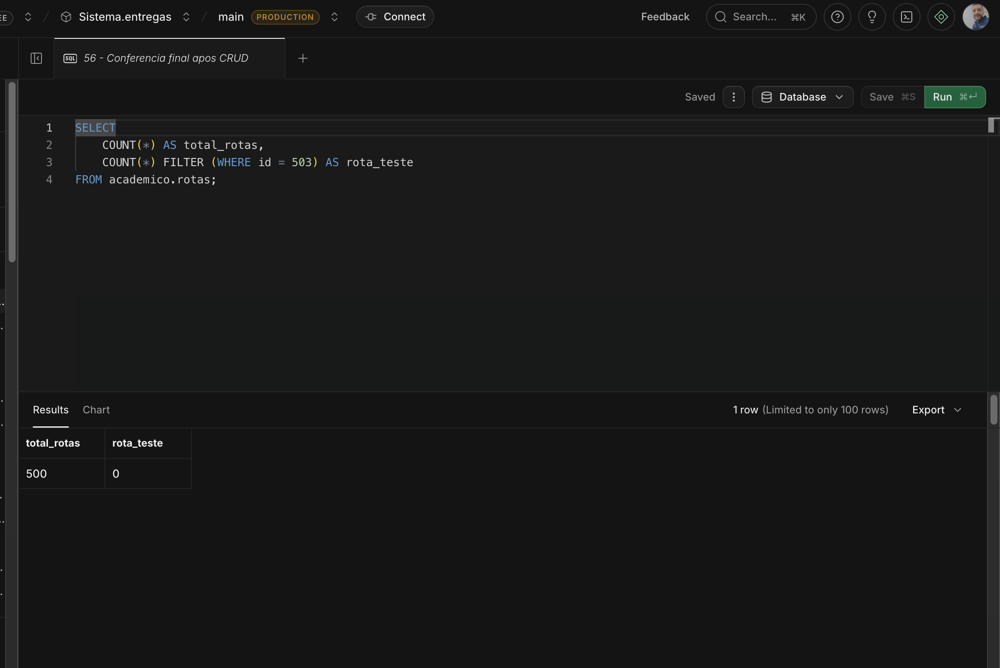

# EntregaFácil — Sistema de Gestão de Encomendas

## Trabalho Final de Modelagem de Banco de Dados

Projeto acadêmico de modelagem e implementação de um banco de dados relacional destinado ao gerenciamento de encomendas, entregadores, rotas e rastreamento de entregas.

| Informação | Descrição |
|---|---|
| Sistema | EntregaFácil |
| Banco de dados | PostgreSQL |
| Plataforma | Supabase |
| Esquema | academico |
| Total de tabelas | 8 |
| Total de registros | 5.000 |
| Relatórios SQL | 10 |
| Evidências | 37 imagens |

---

## 1. Cenário e descrição do problema

### 1.1 Contextualização

A EntregaFácil é uma empresa fictícia especializada em serviços de transporte, distribuição e entrega de encomendas.

A empresa necessita de um sistema centralizado para armazenar informações sobre usuários, entregadores, veículos, encomendas, endereços, rotas e históricos de movimentação.

### 1.2 Problema identificado

A ausência de um banco de dados estruturado pode ocasionar:

- Dificuldade no acompanhamento das encomendas.
- Falta de controle sobre entregadores e rotas.
- Inconsistências nas informações cadastradas.
- Dificuldade na identificação dos endereços de origem e destino.
- Ausência de históricos organizados.
- Limitações na geração de relatórios gerenciais.

### 1.3 Solução proposta

Desenvolvimento de um banco de dados relacional utilizando PostgreSQL e Supabase, permitindo o armazenamento organizado das informações, a integridade referencial, a rastreabilidade das encomendas e a geração de relatórios.

### 1.4 Entidades identificadas

| Entidade | Finalidade |
|---|---|
| Usuarios | Armazenar os dados dos usuários |
| Entregadores | Identificar os responsáveis pelas entregas |
| Encomendas | Registrar os objetos transportados |
| Enderecos | Armazenar origem e destino das encomendas |
| Historico | Registrar movimentações e alterações de status |
| Rotas | Armazenar informações dos trajetos |
| Telefones_usuarios | Armazenar telefones dos usuários |
| Entregadores_rotas | Associar entregadores e rotas |

### 1.5 Classificação dos atributos

| Tipo de atributo | Exemplo |
|---|---|
| Simples | Nome, email e status |
| Composto | Endereço, dividido em rua, número, bairro, cidade, estado e CEP |
| Multivalorado | Telefones de um usuário |
| Derivado | Total de encomendas por usuário, calculado por COUNT |
| Identificador | ID do usuário e código da encomenda |

O atributo multivalorado telefone foi implementado em uma tabela independente. O atributo derivado é calculado por consultas SQL, evitando armazenamento redundante.

---

## 2. Modelagem conceitual

A modelagem conceitual identifica as entidades, seus atributos, relacionamentos e cardinalidades, representando as regras do negócio.

### 2.1 Diagrama Entidade-Relacionamento — DER

### 2.2 Relacionamentos e cardinalidades

| Entidades relacionadas | Cardinalidade |
|---|---|
| Usuarios — Entregadores | 1:1 |
| Usuarios — Encomendas | 1:N |
| Usuarios — Telefones_usuarios | 1:N |
| Entregadores — Encomendas | 1:N |
| Encomendas — Enderecos | 1:N |
| Encomendas — Historico | 1:N |
| Entregadores — Rotas | N:N |

### 2.3 Relacionamento 1:1

Um entregador está associado a um único usuário. Um usuário pode possuir ou não um cadastro de entregador.

### 2.4 Relacionamento 1:N

Um usuário pode possuir várias encomendas e vários telefones.

Uma encomenda pode possuir registros de endereço e diversas movimentações em seu histórico.

Um entregador pode ser responsável por várias encomendas.

### 2.5 Relacionamento N:N

Um entregador pode estar associado a várias rotas, e uma rota pode possuir vários entregadores.

Esse relacionamento foi implementado por meio da tabela associativa entregadores_rotas.

---

## 3. Modelagem lógica

A modelagem lógica transforma as entidades e relacionamentos em tabelas relacionais, definindo atributos, tipos de dados, chaves primárias e estrangeiras.

### 3.1 Modelo lógico relacional

### 3.2 Legenda

- PK: Primary Key — Chave primária.
- FK: Foreign Key — Chave estrangeira.
- UK: Unique Key — Restrição de unicidade.

### 3.3 Dicionário de dados

#### Tabela: usuarios

| Atributo | Tipo | Restrição |
|---|---|---|
| id | UUID | PK |
| nome | VARCHAR(150) | |
| email | VARCHAR(255) | UK |
| criado_em | TIMESTAMPTZ | |

#### Tabela: entregadores

| Atributo | Tipo | Restrição |
|---|---|---|
| id | UUID | PK, FK |
| veiculo | VARCHAR(100) | |
| placa | VARCHAR(10) | |
| ativo | BOOLEAN | |
| criado_em | TIMESTAMPTZ | |

#### Tabela: encomendas

| Atributo | Tipo | Restrição |
|---|---|---|
| codigo | TEXT | PK |
| descricao | TEXT | |
| status | VARCHAR(30) | |
| usuario_id | UUID | FK |
| entregador_id | UUID | FK |
| criado_em | TIMESTAMPTZ | |
| atualizado_em | TIMESTAMPTZ | |

#### Tabela: enderecos

| Atributo | Tipo | Restrição |
|---|---|---|
| id | BIGINT | PK |
| encomenda_codigo | TEXT | FK |
| rua | VARCHAR(150) | |
| numero | VARCHAR(20) | |
| complemento | VARCHAR(100) | |
| bairro | VARCHAR(100) | |
| cep | VARCHAR(9) | |
| cidade | VARCHAR(100) | |
| estado | CHAR(2) | |
| tipo | VARCHAR(20) | CHECK |

A combinação encomenda_codigo e tipo possui restrição UNIQUE, evitando a duplicação de endereços do mesmo tipo para uma encomenda.

#### Tabela: historico

| Atributo | Tipo | Restrição |
|---|---|---|
| id | BIGINT | PK |
| encomenda_codigo | TEXT | FK |
| data | TIMESTAMPTZ | |
| status | VARCHAR(30) | |
| observacao | TEXT | |

#### Tabela: rotas

| Atributo | Tipo | Restrição |
|---|---|---|
| id | BIGINT | PK |
| nome | VARCHAR(100) | |
| data | DATE | |
| distancia_km | NUMERIC(10,2) | CHECK |

#### Tabela: telefones_usuarios

| Atributo | Tipo | Restrição |
|---|---|---|
| id | BIGINT | PK |
| usuario_id | UUID | FK |
| telefone | VARCHAR(20) | |
| tipo | VARCHAR(20) | |

#### Tabela: entregadores_rotas

| Atributo | Tipo | Restrição |
|---|---|---|
| entregador_id | UUID | PK, FK |
| rota_id | BIGINT | PK, FK |

A chave primária composta impede a duplicação de associações entre um entregador e uma mesma rota.

---

## 4. Implementação física

A implementação física foi realizada no PostgreSQL, utilizando a plataforma Supabase e o SQL Editor.

Foi criado um esquema independente denominado academico, destinado exclusivamente ao desenvolvimento deste trabalho.

### 4.1 Recursos utilizados

- CREATE SCHEMA.
- CREATE TABLE.
- PRIMARY KEY.
- FOREIGN KEY.
- UNIQUE.
- CHECK.
- NOT NULL.
- DEFAULT.
- GENERATED ALWAYS AS IDENTITY.
- Integridade referencial.

### 4.2 Scripts de implementação

- [Criação do esquema](sql/01_criacao_schema.sql)
- [Criação das tabelas](sql/02_criacao_tabelas.sql)

### 4.3 Auditoria da estrutura

A auditoria da implementação identificou:

| Elemento | Quantidade |
|---|---:|
| Tabelas | 8 |
| Colunas | 41 |
| Restrições auditadas em pg_constraint | 20 |

### 4.4 Evidências da implementação

As demais evidências apresentam a estrutura detalhada das colunas, tipos de dados, chaves e restrições.

[Acessar todas as evidências da implementação física](prints/01_implementacao_fisica/)

---

## 5. Povoamento e validação dos dados

O banco de dados foi povoado com registros fictícios para fins acadêmicos, respeitando os relacionamentos e as restrições implementadas.

### 5.1 Quantidade de registros

| Tabela | Registros |
|---|---:|
| usuarios | 500 |
| entregadores | 500 |
| encomendas | 500 |
| enderecos | 1.000 |
| historico | 500 |
| rotas | 500 |
| telefones_usuarios | 500 |
| entregadores_rotas | 1.000 |
| **Total** | **5.000** |

Todas as oito tabelas possuem pelo menos 500 registros.

### 5.2 Validação da integridade

Foram realizadas consultas de auditoria para verificar:

- Quantidade de registros por tabela.
- Estrutura das tabelas e colunas.
- Chaves primárias e estrangeiras.
- Restrições de integridade.
- Ausência de vínculos duplicados entre entregadores e rotas.
- Existência de endereços de origem e destino nas 500 encomendas cadastradas.

A validação dos endereços comprova a consistência dos dados atualmente cadastrados. A obrigatoriedade de cadastrar ambos os endereços não é garantida apenas pelas restrições existentes.

### 5.3 Scripts e evidências

- [Script de povoamento](sql/03_povoamento.sql)
- [Script de validações](sql/06_validacoes.sql)
- [Evidências de povoamento e validação](prints/02_povoamento_validacao/)

---

## 6. Operações CRUD

Foram implementadas e demonstradas as quatro operações fundamentais de manipulação de dados utilizando a tabela rotas.

### 6.1 CREATE — Inserção

Inserção de uma rota fictícia denominada Rota Teste CRUD, com distância inicial de 125,50 km.

### 6.2 READ — Consulta

Consulta dos dados da rota inserida.

### 6.3 UPDATE — Atualização

Alteração da distância da rota de teste para 150,00 km.

### 6.4 DELETE — Exclusão

Exclusão da rota fictícia utilizada na demonstração.

### 6.5 Validação da exclusão

Após a exclusão, foi realizada uma consulta para verificar a ausência do registro de teste.

### 6.6 Automatização do CRUD

O script foi aprimorado para capturar automaticamente o ID gerado durante a inserção, utilizando uma tabela temporária e controle de transação.

As evidências originais demonstram a execução manual das operações. Uma evidência complementar comprova o teste da versão automatizada.

Resultado da validação final:

| Verificação | Resultado |
|---|---:|
| Total de rotas após o teste | 500 |
| Existência da rota de teste ID 503 | 0 |

O teste confirmou a exclusão da rota de demonstração e a preservação da quantidade original de registros.

### 6.7 Script e evidências

- [Script das operações CRUD](sql/04_crud.sql)
- [Todas as evidências do CRUD](prints/03_crud/)

---

## 7. Relatórios SQL

Foram desenvolvidos dez relatórios para responder a questões relacionadas à operação da empresa.

As consultas utilizam recursos como SELECT, WHERE, ORDER BY, INNER JOIN, LEFT JOIN, GROUP BY, COUNT e LIMIT.

| Nº | Relatório | Questão de negócio |
|---|---|---|
| 01 | Encomendas por status | Quantas encomendas existem em cada situação? |
| 02 | Ranking de usuários | Quais usuários possuem mais encomendas? |
| 03 | Encomendas em transporte | Quais encomendas estão em transporte e quem são seus entregadores? |
| 04 | Encomendas por cidade | Quais cidades possuem maior volume de encomendas? |
| 05 | Encomendas por veículo | Quais tipos de veículos estão associados a mais encomendas? |
| 06 | Ranking das rotas | Quais rotas possuem as maiores distâncias e quantos entregadores estão associados a elas? |
| 07 | Ranking de entregadores | Quais entregadores ativos estão vinculados a mais rotas? |
| 08 | Movimentações das encomendas | Quais encomendas possuem mais registros de histórico? |
| 09 | Ranking de telefones | Quais usuários possuem mais telefones cadastrados? |
| 10 | Encomendas entregues | Quais encomendas foram entregues e quais são seus destinos? |

### 7.1 Evidências dos relatórios

As 22 imagens abaixo documentam os dez relatórios SQL.

- Relatório 01: [Evidência](prints/04_relatorios/12_relatorio_01_encomendas_por_status.png)
- Relatório 02: [Parte 1](prints/04_relatorios/13_relatorio_02_ranking_usuarios_parte1.png) | [Parte 2](prints/04_relatorios/13_relatorio_02_ranking_usuarios_parte2.png) | [Parte 3](prints/04_relatorios/13_relatorio_02_ranking_usuarios_parte3.png)
- Relatório 03: [Parte 1](prints/04_relatorios/14_relatorio_03_encomendas_em_transporte_parte1.png) | [Parte 2](prints/04_relatorios/14_relatorio_03_encomendas_em_transporte_parte2.png)
- Relatório 04: [Evidência](prints/04_relatorios/15_relatorio_04_encomendas_por_cidade.png)
- Relatório 05: [Evidência](prints/04_relatorios/16_relatorio_05_encomendas_por_veiculo.png)
- Relatório 06: [Parte 1](prints/04_relatorios/17_relatorio_06_ranking_rotas_parte1.png) | [Parte 2](prints/04_relatorios/17_relatorio_06_ranking_rotas_parte2.png) | [Parte 3](prints/04_relatorios/17_relatorio_06_ranking_rotas_parte3.png)
- Relatório 07: [Parte 1](prints/04_relatorios/18_relatorio_07_ranking_entregadores_parte1.png) | [Parte 2](prints/04_relatorios/18_relatorio_07_ranking_entregadores_parte2.png) | [Parte 3](prints/04_relatorios/18_relatorio_07_ranking_entregadores_parte3.png)
- Relatório 08: [Parte 1](prints/04_relatorios/19_relatorio_08_movimentacoes_encomendas_parte1.png) | [Parte 2](prints/04_relatorios/19_relatorio_08_movimentacoes_encomendas_parte2.png) | [Parte 3](prints/04_relatorios/19_relatorio_08_movimentacoes_encomendas_parte3.png)
- Relatório 09: [Parte 1](prints/04_relatorios/20_relatorio_09_ranking_telefones_parte1.png) | [Parte 2](prints/04_relatorios/20_relatorio_09_ranking_telefones_parte2.png) | [Parte 3](prints/04_relatorios/20_relatorio_09_ranking_telefones_parte3.png)
- Relatório 10: [Parte 1](prints/04_relatorios/21_relatorio_10_encomendas_entregues_parte1.png) | [Parte 2](prints/04_relatorios/21_relatorio_10_encomendas_entregues_parte2.png)

### 7.2 Script dos relatórios

[Acessar os dez relatórios SQL](sql/05_relatorios.sql)

---

## 8. Tecnologias utilizadas

- PostgreSQL — Sistema gerenciador de banco de dados.
- Supabase — Plataforma de implementação e gerenciamento.
- SQL — Linguagem de definição, manipulação e consulta de dados.
- GitHub — Versionamento e disponibilização do projeto.
- Markdown — Documentação técnica.
- ChatGPT (OpenAI) — Inteligência artificial generativa utilizada no desenvolvimento colaborativo, aprendizado, revisão e documentação do projeto.

---

## 9. Organização do repositório

    trabalho-final-banco-de-dados/
    |
    |-- diagramas/
    |   |-- der_conceitual.png
    |   |-- modelo_logico.png
    |
    |-- prints/
    |   |-- 01_implementacao_fisica/
    |   |-- 02_povoamento_validacao/
    |   |-- 03_crud/
    |   |-- 04_relatorios/
    |
    |-- sql/
    |   |-- 01_criacao_schema.sql
    |   |-- 02_criacao_tabelas.sql
    |   |-- 03_povoamento.sql
    |   |-- 04_crud.sql
    |   |-- 05_relatorios.sql
    |   |-- 06_validacoes.sql
    |
    |-- README.md

---

### 9.1 Distribuição das evidências

| Pasta | Imagens |
|---|---:|
| 01_implementacao_fisica | 6 |
| 02_povoamento_validacao | 3 |
| 03_crud | 6 |
| 04_relatorios | 22 |
| **Total** | **37** |

---

## 10. Instruções de execução

Para reproduzir o projeto, utilize um banco PostgreSQL ou um projeto Supabase destinado a testes.

Execute os scripts na seguinte ordem:

1. 01_criacao_schema.sql
2. 02_criacao_tabelas.sql
3. 03_povoamento.sql
4. 04_crud.sql
5. 05_relatorios.sql
6. 06_validacoes.sql

O script CRUD deve ser executado integralmente na mesma sessão, permitindo a utilização da tabela temporária.

Os scripts de criação e povoamento devem ser utilizados preferencialmente em um ambiente novo, evitando conflitos com estruturas e registros existentes.

---

## 11. Conferência dos requisitos acadêmicos

| Requisito | Valor | Evidência |
|---|---:|---|
| Cenário | 1,0 | Seção 1 |
| Modelagem conceitual | 1,5 | Seção 2 |
| Modelagem lógica | 1,5 | Seção 3 |
| Implementação física | 2,0 | Seção 4 |
| Povoamento | 1,0 | Seção 5 |
| CRUD | 1,0 | Seção 6 |
| Relatórios SQL | 2,0 | Seção 7 |
| **Total possível** | **10,0** | |

---

## 12. Conclusão

O projeto EntregaFácil demonstra a aplicação prática dos conceitos de modelagem conceitual, lógica e física de bancos de dados relacionais.

A implementação contempla oito tabelas, relacionamentos de diferentes cardinalidades, restrições de integridade, 5.000 registros fictícios, operações CRUD e dez relatórios SQL.

O projeto permite compreender as etapas de desenvolvimento de um banco de dados, desde a identificação das necessidades do negócio até a implementação, manipulação, validação e consulta das informações.

---

## 13. Utilização de Inteligência Artificial no Desenvolvimento

Conforme a orientação do professor, este projeto foi desenvolvido com o auxílio de Inteligência Artificial Generativa, utilizando o ChatGPT, desenvolvido pela OpenAI, como ferramenta de apoio técnico, educacional e colaborativo.

A inteligência artificial participou de todas as etapas do desenvolvimento, auxiliando nas seguintes atividades:

- Definição do cenário e identificação das necessidades do negócio.
- Levantamento das entidades, atributos e relacionamentos.
- Desenvolvimento e revisão da modelagem conceitual e lógica.
- Elaboração e correção dos diagramas DER e MER.
- Desenvolvimento dos scripts SQL.
- Implementação física do banco de dados no Supabase.
- Geração de 5.000 registros fictícios.
- Identificação, análise e correção de erros.
- Elaboração de consultas de auditoria e validação.
- Desenvolvimento e aprimoramento das operações CRUD.
- Elaboração dos dez relatórios SQL.
- Organização e versionamento dos arquivos no GitHub.
- Elaboração e revisão da documentação técnica.

O desenvolvimento ocorreu de maneira colaborativa e interativa entre o estudante e a inteligência artificial, por meio de orientações, explicações, sugestões, revisões e testes sucessivos.

Os códigos sugeridos pela inteligência artificial foram executados e avaliados pelo estudante no ambiente Supabase, permitindo a identificação de inconsistências, a realização de ajustes e a validação dos resultados obtidos.

A utilização da IA não se limitou à geração de códigos, mas também contribuiu para a compreensão dos conceitos de modelagem de banco de dados, linguagem SQL, integridade referencial, resolução de problemas e documentação de software.

### 13.1 Ferramenta utilizada

| Informação | Descrição |
|---|---|
| Ferramenta | ChatGPT |
| Desenvolvedor | OpenAI |
| Tecnologia | Inteligência Artificial Generativa |
| Finalidade | Apoio técnico, educacional e colaborativo |
| Participação | Todas as etapas do desenvolvimento |

Site oficial: [ChatGPT — OpenAI](https://chatgpt.com/)

### 13.2 Responsabilidade acadêmica

A inteligência artificial foi utilizada como ferramenta de apoio ao desenvolvimento, conforme a orientação do professor.

O estudante participou ativamente das decisões, da implementação, da execução dos códigos, dos testes, das validações e da organização final do projeto, assumindo a responsabilidade acadêmica pelo trabalho apresentado.

### 13.3 Registro do desenvolvimento com IA

Como forma de transparência acadêmica e documentação
do processo de aprendizagem, disponibiliza-se o registro
da interação com o ChatGPT durante o desenvolvimento
do projeto EntregaFácil.

O histórico permite acompanhar as decisões técnicas,
orientações, dificuldades encontradas, correções,
testes e validações realizados ao longo do projeto.

[Acessar o histórico de desenvolvimento com o ChatGPT](https://chatgpt.com/share/6b0b0ec0-2b34-83e8-92b5-6ad39a322807)

---

**EntregaFácil — Trabalho Final de Modelagem de Banco de Dados**

Projeto desenvolvido para fins acadêmicos.
